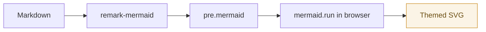

The scaffold is live: Astro, content collections, and the design tokens are
wired up, and this is the first published post.

## What's here

Posts, projects, and an about page, all static and deployed from `main`.

```go
func main() {
	// A tiny sample to check syntax highlighting.
	msg := "hello, blog"
	fmt.Println(msg)
}
```

## Rendering pipeline

Diagrams render client-side from the `mermaid` fence, themed to match the page:



## What's next

Real writing, a Keystone deep-dive, and the Phase 2 design pass.
