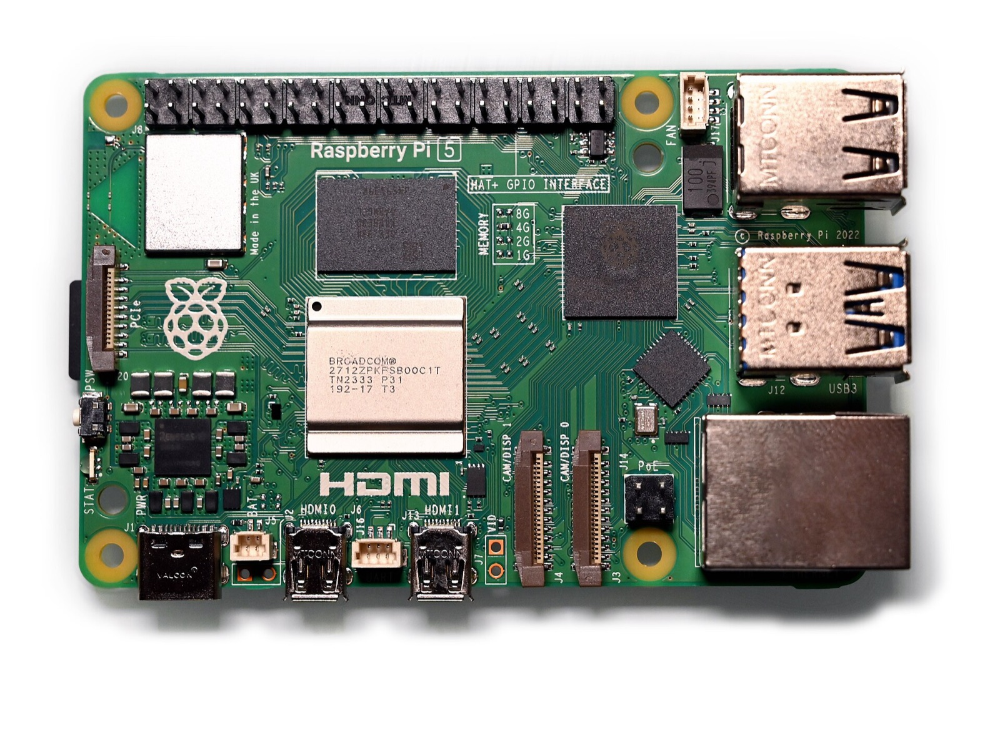
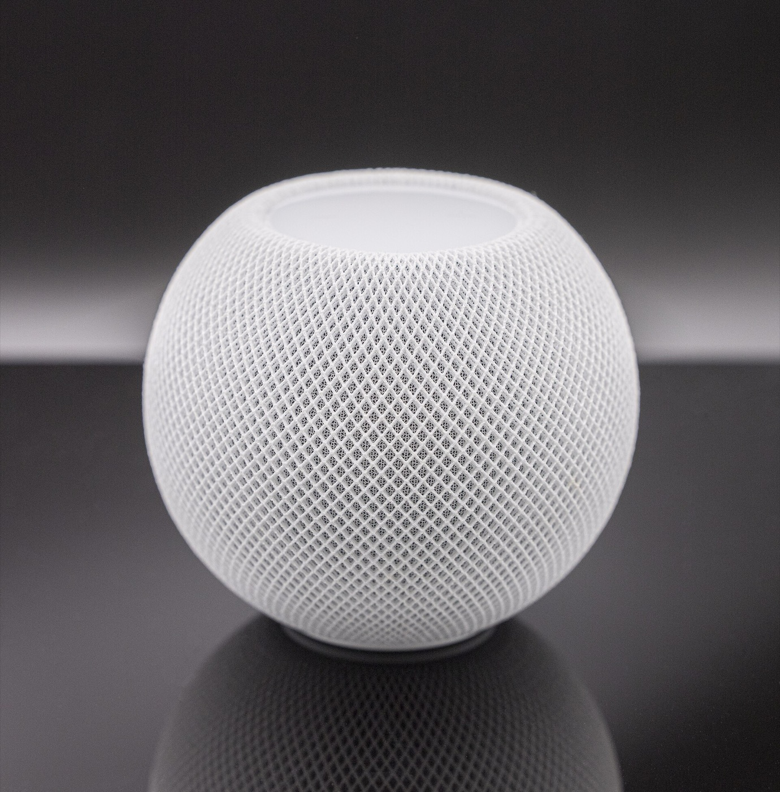
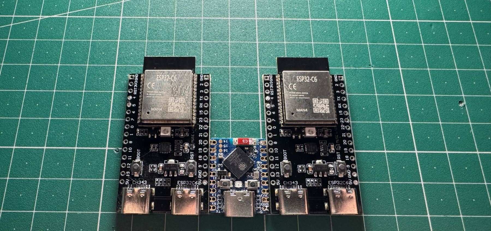
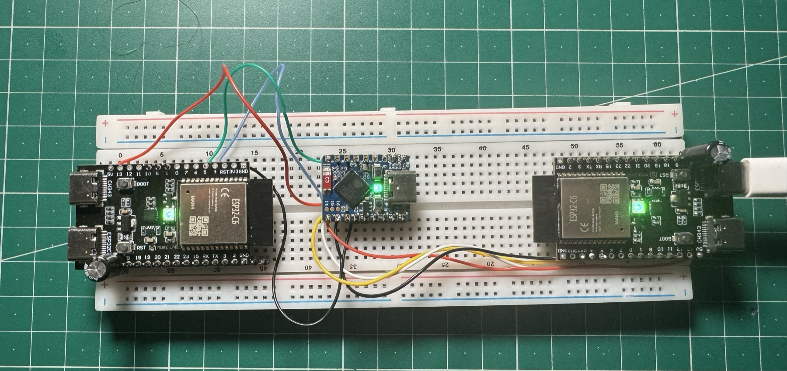

*"Building a smart home from scratch"*

## Where it started: four ecosystems, four islands

I had two hubs at home — an IKEA Dirigera and an Apple HomePod — and each works
beautifully inside its own ecosystem. The problem is the wall between them. You
can't add an IKEA plug directly to Apple Home. A Matter device won't pair in the
IKEA app. The HomePod can't see half of what Dirigera sees, and vice versa. And
then there's an air conditioner on Tuya, with its own app.

Four islands, and each one does exactly what its vendor allows.

<figure class="diagram" role="img" aria-label="Home Assistant connected to four otherwise-separate ecosystems: IKEA Dirigera, Apple HomePod, a Tuya air conditioner, and Matter devices." style="margin:30px 0">
<svg viewBox="0 0 720 262" xmlns="http://www.w3.org/2000/svg" style="width:100%;height:auto;display:block">
  <defs><filter id="ks-isl-shadow" x="-20%" y="-40%" width="140%" height="180%"><feDropShadow dx="0" dy="3" stdDeviation="5" flood-color="#000000" flood-opacity="0.10"/></filter></defs>
  <rect x="6" y="6" width="708" height="250" rx="18" style="fill:var(--muted);stroke:var(--border)" stroke-width="1"/>
  <circle cx="70" cy="226" r="120" style="fill:var(--primary)" opacity="0.05"/>
  <g fill="none" style="stroke:var(--muted-foreground)" stroke-width="2" stroke-linecap="round" stroke-dasharray="0.5 7" opacity="0.8">
    <path d="M360 94 C 360 148 114 150 114 180"/>
    <path d="M360 94 C 360 148 278 150 278 180"/>
    <path d="M360 94 C 360 148 442 150 442 180"/>
    <path d="M360 94 C 360 148 606 150 606 180"/>
  </g>
  <g filter="url(#ks-isl-shadow)"><rect x="233" y="34" width="254" height="60" rx="30" style="fill:var(--card);stroke:var(--primary)" stroke-width="2"/></g>
  <circle cx="267" cy="64" r="15" style="fill:var(--primary)"/>
  <g style="stroke:var(--card)" stroke-width="1.6" stroke-linecap="round" fill="none"><path d="M267 57 V61 M267 67 V71 M260 64 H264 M270 64 H274"/><circle cx="267" cy="64" r="2.4" style="fill:var(--card)"/></g>
  <text x="293" y="61" style="fill:var(--foreground);font-family:var(--font-sans);font-size:16px;font-weight:600">Home Assistant</text>
  <text x="293" y="79" style="fill:var(--muted-foreground);font-family:var(--font-mono);font-size:10px;letter-spacing:0.02em">one hub · every protocol</text>
  <g filter="url(#ks-isl-shadow)"><rect x="39" y="180" width="150" height="56" rx="28" style="fill:var(--card);stroke:var(--border)" stroke-width="1.5"/></g>
  <circle cx="69" cy="208" r="11" style="fill:var(--muted);stroke:var(--border)" stroke-width="1"/>
  <rect x="64" y="203" width="10" height="10" rx="2" style="fill:none;stroke:var(--muted-foreground)" stroke-width="1.4"/>
  <text x="89" y="204" style="fill:var(--foreground);font-family:var(--font-sans);font-size:13.5px;font-weight:600">Dirigera</text>
  <text x="89" y="220" style="fill:var(--muted-foreground);font-family:var(--font-mono);font-size:10.5px">IKEA hub</text>
  <g filter="url(#ks-isl-shadow)"><rect x="203" y="180" width="150" height="56" rx="28" style="fill:var(--card);stroke:var(--border)" stroke-width="1.5"/></g>
  <circle cx="233" cy="208" r="11" style="fill:var(--muted);stroke:var(--border)" stroke-width="1"/>
  <rect x="228" y="203" width="10" height="10" rx="2" style="fill:none;stroke:var(--muted-foreground)" stroke-width="1.4"/>
  <text x="253" y="204" style="fill:var(--foreground);font-family:var(--font-sans);font-size:13.5px;font-weight:600">HomePod</text>
  <text x="253" y="220" style="fill:var(--muted-foreground);font-family:var(--font-mono);font-size:10.5px">Apple</text>
  <g filter="url(#ks-isl-shadow)"><rect x="367" y="180" width="150" height="56" rx="28" style="fill:var(--card);stroke:var(--border)" stroke-width="1.5"/></g>
  <circle cx="397" cy="208" r="11" style="fill:var(--muted);stroke:var(--border)" stroke-width="1"/>
  <rect x="392" y="203" width="10" height="10" rx="2" style="fill:none;stroke:var(--muted-foreground)" stroke-width="1.4"/>
  <text x="417" y="204" style="fill:var(--foreground);font-family:var(--font-sans);font-size:13.5px;font-weight:600">Tuya AC</text>
  <text x="417" y="220" style="fill:var(--muted-foreground);font-family:var(--font-mono);font-size:10.5px">air con</text>
  <g filter="url(#ks-isl-shadow)"><rect x="531" y="180" width="150" height="56" rx="28" style="fill:var(--card);stroke:var(--border)" stroke-width="1.5"/></g>
  <circle cx="561" cy="208" r="11" style="fill:var(--muted);stroke:var(--border)" stroke-width="1"/>
  <rect x="556" y="203" width="10" height="10" rx="2" style="fill:none;stroke:var(--muted-foreground)" stroke-width="1.4"/>
  <text x="581" y="204" style="fill:var(--foreground);font-family:var(--font-sans);font-size:13.5px;font-weight:600">Matter</text>
  <text x="581" y="220" style="fill:var(--muted-foreground);font-family:var(--font-mono);font-size:10.5px">devices</text>
</svg>
</figure>

## Home Assistant connects everything — but you pay in more than money

There is a system that can connect these islands: Home Assistant. It supports
practically every common smart-home protocol. It's how I automated the AC for
the summer, for instance: it switches on from an IKEA temperature sensor. None
of Dirigera, Apple Home, or the AC's own app can do that on its own. Home
Assistant's strength is its universality.

<figure class="diagram" role="img" aria-label="An IKEA temperature sensor triggers Home Assistant, which switches on a Tuya air conditioner." style="margin:30px 0">
<svg viewBox="0 0 720 168" xmlns="http://www.w3.org/2000/svg" style="width:100%;height:auto;display:block">
  <defs><filter id="ks-brg-shadow" x="-20%" y="-50%" width="140%" height="200%"><feDropShadow dx="0" dy="3" stdDeviation="5" flood-color="#000000" flood-opacity="0.10"/></filter></defs>
  <rect x="6" y="6" width="708" height="156" rx="18" style="fill:var(--muted);stroke:var(--border)" stroke-width="1"/>
  <circle cx="650" cy="28" r="95" style="fill:var(--primary)" opacity="0.05"/>
  <g fill="none" style="stroke:var(--muted-foreground)" stroke-width="2" stroke-linecap="round" stroke-dasharray="0.5 7" opacity="0.85">
    <path d="M220 84 H258"/>
    <path d="M450 84 H488"/>
  </g>
  <polygon points="257,79 267,84 257,89" style="fill:var(--muted-foreground)"/>
  <polygon points="487,79 497,84 487,89" style="fill:var(--muted-foreground)"/>
  <g filter="url(#ks-brg-shadow)"><rect x="30" y="53" width="190" height="62" rx="31" style="fill:var(--card);stroke:var(--border)" stroke-width="1.5"/></g>
  <circle cx="62" cy="84" r="13" style="fill:var(--muted);stroke:var(--border)" stroke-width="1"/>
  <g fill="none" style="stroke:var(--muted-foreground)" stroke-width="1.6" stroke-linecap="round"><path d="M62 78 v7"/></g>
  <circle cx="62" cy="88" r="2.6" style="fill:var(--muted-foreground)"/>
  <text x="84" y="81" style="fill:var(--foreground);font-family:var(--font-sans);font-size:15px;font-weight:600">IKEA sensor</text>
  <text x="84" y="98" style="fill:var(--muted-foreground);font-family:var(--font-mono);font-size:11px">temperature</text>
  <g filter="url(#ks-brg-shadow)"><rect x="270" y="53" width="180" height="62" rx="31" style="fill:var(--card);stroke:var(--primary)" stroke-width="2"/></g>
  <circle cx="302" cy="84" r="14" style="fill:var(--primary)"/>
  <g style="stroke:var(--card)" stroke-width="1.6" stroke-linecap="round" fill="none"><path d="M302 77 V81 M302 87 V91 M295 84 H299 M305 84 H309"/><circle cx="302" cy="84" r="2.4" style="fill:var(--card)"/></g>
  <text x="326" y="81" style="fill:var(--foreground);font-family:var(--font-sans);font-size:15px;font-weight:600">Home Assistant</text>
  <text x="326" y="98" style="fill:var(--muted-foreground);font-family:var(--font-mono);font-size:11px">the bridge</text>
  <g filter="url(#ks-brg-shadow)"><rect x="500" y="53" width="190" height="62" rx="31" style="fill:var(--card);stroke:var(--border)" stroke-width="1.5"/></g>
  <circle cx="532" cy="84" r="13" style="fill:var(--muted);stroke:var(--border)" stroke-width="1"/>
  <g fill="none" style="stroke:var(--muted-foreground)" stroke-width="1.5" stroke-linecap="round"><path d="M532 77 v14 M526 80.5 l12 7 M538 80.5 l-12 7"/></g>
  <text x="554" y="81" style="fill:var(--foreground);font-family:var(--font-sans);font-size:15px;font-weight:600">Tuya AC</text>
  <text x="554" y="98" style="fill:var(--muted-foreground);font-family:var(--font-mono);font-size:11px">cools the room</text>
</svg>
</figure>

*The one automation none of the apps could do on its own: an IKEA sensor
switching on a Tuya AC — bridged by Home Assistant.*

But you pay for it, and not only in money. A Raspberry Pi 5 with 4 GB of RAM
now runs €130–140. The market has gone a little mad: a memory shortage has pushed
prices up again, and this is no longer the cheap single-board computer the
Raspberry Pi was meant to be. And what runs on it is a
Python application that, for my needs, would be perfectly happy on far weaker
hardware.

*A Raspberry Pi 5 — a full Linux computer, just to switch a few plugs on and off. Photo: [Simon Waldherr](https://commons.wikimedia.org/wiki/File:Raspberry_Pi_5.jpg), [CC BY 4.0](https://creativecommons.org/licenses/by/4.0/).*

The second problem is the interface. It's overloaded and not especially
friendly: to get a handle on automations I had to literally sit down and study
the system. Home Assistant is enormous, and I use only a small slice of what it
can do.

And the problem isn't only me. Even once you've set everything up, that doesn't
mean your family can use it. You end up as the living "Siri" for your own home —
the one person who remembers which button to tap to turn on the AC. A smart home
that only one person in the family can operate isn't very smart.

## Apple Home — simple, but it barely automates

The obvious answer would be Apple Home. It's simple, and the whole family already
knows how to use it. But here the problem is reversed: it can barely do anything.
Its automation is badly limited. Even something as simple as "switch the plug off
half an hour after it turns on" is hard to build with the stock tools: Shortcuts
is more a kit for short scenes than a real automation engine.

*The HomePod mini: simple enough for the whole family — and barely able to automate. Photo: [Arne Müseler / arne-mueseler.com](https://www.arne-mueseler.com) / [CC BY-SA 3.0](https://creativecommons.org/licenses/by-sa/3.0/de/deed.en).*

However hard I tried, I never found a scenario I'd actually use regularly. And
timers — the thing that could have been the most useful — don't work the way I'd
want. You have to build a delay out of the Wait action, in one-second steps. Try
setting several hours that way. And it can't guarantee the automation fires
exactly after a set interval anyway.

## IKEA — timers and schedules, but walled in

Curiously, the timers and schedules Apple Home lacks are right there in the IKEA
app. It's simple, and they all work. But there are two problems. First, it works
well mostly with IKEA's own range. Dirigera accepts Matter devices, but with
limits: by IKEA's own account, it mainly supports the device types the company
sells itself. Second, even with its own devices things aren't always stable: the
hub hangs, forgets to turn something off, and so on. Step outside the lines and
you're up against the wall of your own ecosystem again.

## The trilemma

So it's a closed loop. Home Assistant can do almost anything but is too complex
for the whole family to use day to day. Apple Home is simple and familiar but
short on automation. IKEA offers convenient timers and schedules but is boxed
into its own range and isn't always reliable.

<figure class="diagram" role="img" aria-label="Home Assistant, Apple Home and the IKEA app each solve part of the problem and fall short of a home the whole family can automate locally and reliably." style="margin:30px 0">
<svg viewBox="0 0 720 300" xmlns="http://www.w3.org/2000/svg" style="width:100%;height:auto;display:block">
  <defs><filter id="ks-tri-shadow" x="-20%" y="-30%" width="140%" height="160%"><feDropShadow dx="0" dy="3" stdDeviation="5" flood-color="#000000" flood-opacity="0.10"/></filter></defs>
  <rect x="6" y="6" width="708" height="288" rx="18" style="fill:var(--muted);stroke:var(--border)" stroke-width="1"/>
  <circle cx="360" cy="252" r="150" style="fill:var(--primary)" opacity="0.05"/>
  <g fill="none" style="stroke:var(--muted-foreground)" stroke-width="2" stroke-linecap="round" stroke-dasharray="0.5 7" opacity="0.8">
    <path d="M124 126 C 124 172 360 166 360 206"/>
    <path d="M360 126 V206"/>
    <path d="M596 126 C 596 172 360 166 360 206"/>
  </g>
  <polygon points="353,199 367,199 360,208" style="fill:var(--muted-foreground)"/>
  <g filter="url(#ks-tri-shadow)"><rect x="18" y="28" width="212" height="98" rx="14" style="fill:var(--card);stroke:var(--border)" stroke-width="1.5"/></g>
  <text x="38" y="58" style="fill:var(--foreground);font-family:var(--font-sans);font-size:15px;font-weight:600">Home Assistant</text>
  <text x="38" y="81" style="font-family:var(--font-sans);font-size:12.5px"><tspan style="fill:var(--status-active-fg);font-weight:700">✓ </tspan><tspan style="fill:var(--muted-foreground)">connects everything</tspan></text>
  <text x="38" y="101" style="font-family:var(--font-sans);font-size:12.5px"><tspan style="fill:var(--destructive);font-weight:700">✗ </tspan><tspan style="fill:var(--muted-foreground)">complex · pricey · solo</tspan></text>
  <g filter="url(#ks-tri-shadow)"><rect x="254" y="28" width="212" height="98" rx="14" style="fill:var(--card);stroke:var(--border)" stroke-width="1.5"/></g>
  <text x="274" y="58" style="fill:var(--foreground);font-family:var(--font-sans);font-size:15px;font-weight:600">Apple Home</text>
  <text x="274" y="81" style="font-family:var(--font-sans);font-size:12.5px"><tspan style="fill:var(--status-active-fg);font-weight:700">✓ </tspan><tspan style="fill:var(--muted-foreground)">simple · family-ready</tspan></text>
  <text x="274" y="101" style="font-family:var(--font-sans);font-size:12.5px"><tspan style="fill:var(--destructive);font-weight:700">✗ </tspan><tspan style="fill:var(--muted-foreground)">barely automates</tspan></text>
  <g filter="url(#ks-tri-shadow)"><rect x="490" y="28" width="212" height="98" rx="14" style="fill:var(--card);stroke:var(--border)" stroke-width="1.5"/></g>
  <text x="510" y="58" style="fill:var(--foreground);font-family:var(--font-sans);font-size:15px;font-weight:600">IKEA app</text>
  <text x="510" y="81" style="font-family:var(--font-sans);font-size:12.5px"><tspan style="fill:var(--status-active-fg);font-weight:700">✓ </tspan><tspan style="fill:var(--muted-foreground)">timers and schedules</tspan></text>
  <text x="510" y="101" style="font-family:var(--font-sans);font-size:12.5px"><tspan style="fill:var(--destructive);font-weight:700">✗ </tspan><tspan style="fill:var(--muted-foreground)">own range · flaky</tspan></text>
  <g filter="url(#ks-tri-shadow)"><rect x="180" y="206" width="360" height="64" rx="32" style="fill:var(--card);stroke:var(--primary)" stroke-width="2"/></g>
  <circle cx="214" cy="238" r="16" style="fill:var(--primary)"/>
  <g style="stroke:var(--card)" stroke-width="2" stroke-linecap="round" stroke-linejoin="round" fill="none"><path d="M207 238 l4.5 5 l8.5 -10"/></g>
  <text x="242" y="234" style="fill:var(--foreground);font-family:var(--font-sans);font-size:14.5px;font-weight:600">A home the family can automate</text>
  <text x="242" y="251" style="fill:var(--muted-foreground);font-family:var(--font-mono);font-size:11px;letter-spacing:0.03em">local · cheap · reliable</text>
</svg>
</figure>

*Each one covers a different corner. None of them covers all three.*

## One small box instead

I wanted something else: a small box that runs the home's logic itself — rules,
timers, schedules — and exposes simple control through the interfaces everyone
already uses.

And for that, it turns out, you don't need a full computer at €130–140. All of
Keystone fits in three ESP32 modules: a brain on an ESP32-S3 at around €6, and
two ESP32-C6 radio chips at €7–8 each. About €20–25 for all the hardware. Five
or six times cheaper than a single Raspberry Pi, and with far lower power draw.

*The future smart-home hub: three ESP32 chips, about €20–25 for all the hardware.*

I wanted a small box that does exactly what I need — a device whose architecture
I understand end to end, and that the whole family can use.

And that, really, is what annoys me about the whole smart-home industry. The
technology has been maturing for years, yet beyond lighting there's still little
that's genuinely smart. There isn't enough simplicity and flexibility for anyone
but an enthusiast — one willing to spend a weekend setting up yet another
automation — to actually use it.

## What I wanted

The list of requirements turned out quite short:

1. **No cloud.** The home has to work without the internet. If Amazon goes down,
   the lights still have to come on.
2. **One box.** The hub plugs straight into the wall. No separate Zigbee USB
   dongles, no Raspberry Pi. Just a small device.
3. **Apple Home for the family, my own app for me.** The household controls
   devices through the familiar Apple Home — Matter is an open standard, no need
   to breed yet another app. I, meanwhile, want my own app for setup and control.
   And if I can make it simple enough, the whole family can use that too.

## Architecture: a brain plus radios

The bet is on simple, cheap hardware. The ESP32 is a microcontroller costing a
few euros — and, as it turns out, quite enough for a smart home.

We once sent a person into space with 4 KB of memory; holding 4 GB just to
switch lamps on and off feels extravagant today. Especially when a few
microcontrollers will do.

The core idea is to separate the home's logic from the radio. One chip thinks;
the rest only move data:

<figure class="diagram" role="img" aria-label="A Brain chip on ESP32-S3 connected over UART to a Zigbee radio and a Matter radio, each on an ESP32-C6." style="margin:30px 0">
<svg viewBox="0 0 720 320" xmlns="http://www.w3.org/2000/svg" style="width:100%;height:auto;display:block">
  <defs>
    <filter id="ks-arch-shadow" x="-20%" y="-40%" width="140%" height="180%">
      <feDropShadow dx="0" dy="3" stdDeviation="5" flood-color="#000000" flood-opacity="0.10"/>
    </filter>
  </defs>

  <rect x="6" y="6" width="708" height="308" rx="18" style="fill:var(--muted);stroke:var(--border)" stroke-width="1"/>
  <circle cx="648" cy="42" r="130" style="fill:var(--primary)" opacity="0.06"/>

  <g fill="none" style="stroke:var(--muted-foreground)" stroke-width="2" stroke-linecap="round" stroke-dasharray="0.5 7" opacity="0.85">
    <path d="M322 150 C 372 150 382 104 428 104"/>
    <path d="M322 170 C 372 170 382 216 428 216"/>
  </g>

  <rect x="350" y="93" width="54" height="22" rx="11" style="fill:var(--background);stroke:var(--border)" stroke-width="1"/>
  <text x="377" y="108" text-anchor="middle" style="fill:var(--muted-foreground);font-family:var(--font-mono);font-size:11px;letter-spacing:0.06em">UART</text>
  <rect x="350" y="205" width="54" height="22" rx="11" style="fill:var(--background);stroke:var(--border)" stroke-width="1"/>
  <text x="377" y="220" text-anchor="middle" style="fill:var(--muted-foreground);font-family:var(--font-mono);font-size:11px;letter-spacing:0.06em">UART</text>

  <g filter="url(#ks-arch-shadow)">
    <rect x="64" y="128" width="258" height="64" rx="32" style="fill:var(--card);stroke:var(--primary)" stroke-width="2"/>
  </g>
  <circle cx="100" cy="160" r="16" style="fill:var(--primary)"/>
  <g style="stroke:var(--card)" stroke-width="1.6" fill="none" stroke-linecap="round">
    <rect x="94.5" y="154.5" width="11" height="11" rx="2.5"/>
    <path d="M100 154.5 v-3 M100 165.5 v3 M94.5 160 h-3 M105.5 160 h3"/>
  </g>
  <text x="128" y="158" style="fill:var(--foreground);font-family:var(--font-sans);font-size:17px;font-weight:600">Brain</text>
  <text x="128" y="176" style="fill:var(--muted-foreground);font-family:var(--font-mono);font-size:11.5px;letter-spacing:0.04em">ESP32-S3 · logic core</text>

  <g filter="url(#ks-arch-shadow)">
    <rect x="428" y="74" width="232" height="60" rx="30" style="fill:var(--card);stroke:var(--border)" stroke-width="1.5"/>
  </g>
  <circle cx="460" cy="104" r="14" style="fill:var(--muted);stroke:var(--border)" stroke-width="1"/>
  <g fill="none" style="stroke:var(--muted-foreground)" stroke-width="1.6" stroke-linecap="round">
    <path d="M454 108 q6 -11 12 0"/>
    <path d="M451 111 q9 -16 18 0"/>
  </g>
  <text x="486" y="102" style="fill:var(--foreground);font-family:var(--font-sans);font-size:16px;font-weight:600">Zigbee radio</text>
  <text x="486" y="119" style="fill:var(--muted-foreground);font-family:var(--font-mono);font-size:11.5px;letter-spacing:0.04em">ESP32-C6 · 802.15.4</text>

  <g filter="url(#ks-arch-shadow)">
    <rect x="428" y="186" width="232" height="60" rx="30" style="fill:var(--card);stroke:var(--border)" stroke-width="1.5"/>
  </g>
  <circle cx="460" cy="216" r="14" style="fill:var(--muted);stroke:var(--border)" stroke-width="1"/>
  <g fill="none" style="stroke:var(--muted-foreground)" stroke-width="1.6" stroke-linejoin="round">
    <polygon points="460,208 467,216 460,224 453,216"/>
  </g>
  <text x="486" y="214" style="fill:var(--foreground);font-family:var(--font-sans);font-size:16px;font-weight:600">Matter radio</text>
  <text x="486" y="231" style="fill:var(--muted-foreground);font-family:var(--font-mono);font-size:11.5px;letter-spacing:0.04em">ESP32-C6 · Thread</text>
</svg>
</figure>

*Keystone today: the ESP32-S3 Zero brain and its two ESP32-C6 radios, powered up and talking over UART on the bench.*

The brain (ESP32-S3) knows about entities (a plug, a sensor), their states
(on/off), and rules (for example: draw above 5 W — switch off). It does no radio
work: no Zigbee SDK or Matter SDK inside the logic core. It can be built and
tested on an ordinary laptop (CMake + doctest), without a single board.

The Zigbee chip (ESP32-C6) does only Zigbee. It translates Zigbee commands and
events into messages of the internal `hubproto` protocol and sends them to the
brain over UART.

The Matter chip (ESP32-C6) presents the brain's entities as Matter Bridge
devices. Thanks to that, Apple Home can see and control Zigbee devices through
Matter.

## Why: brain apart, radio apart

Splitting the brain from the radio chips isn't just an implementation detail —
it's one of the architecture's main principles. The hardware's limits pushed me
toward it first.

Zigbee and Thread use the same 802.15.4 radio. Multiprotocol solutions exist
that let one radio serve both, but I chose not to complicate the architecture and
to keep them separate. Each protocol gets its own chip and doesn't get in the
other's way. Memory tells a similar story: full Matter and Zigbee stacks together
with the home's logic are too much for a small controller.

So you end up with three chips: one for logic, two for radio. But that split
brings several extra advantages.

**Portability.** Radio stacks are huge and tied to a specific vendor.
`esp-zigbee-sdk` and `esp-matter` are large SDKs with their own toolchains and
dependencies. Keep the home's logic away from them, and you can move it almost
anywhere.

The brain's core compiles and runs its tests on an ordinary laptop (CMake +
doctest), without a single board. If in a couple of years I want to move from the
ESP32 to a Linux board or a different microcontroller, I won't have to rewrite
the rules, timers, and scenes. Only the platform layer and the transport change.

**Resilience.** A radio chip can be rebooted, updated over the air, or even lost
entirely — the brain keeps working. It notices a chip restarting and rebuilds its
picture of the world. For that, each radio chip has its own boot counter.

A new radio protocol — another Thread, Zigbee, or something else — can also be
added as a separate chip, without touching the main logic.

**Simple links.** Between the brain and the radio chips there's just a wire
(UART) and a small binary protocol on top: a few header bytes, framing, and a
checksum. How it works, and why I chose a binary format, is the subject of the
next article.

## What's in the series

This article is an introduction to the project. Next I'll take Keystone apart
piece by piece and tell you how it all works inside:

- **The protocol between chips** — framing, checksum, and a compact binary format
- **The brain's logic** — entity registry, states, rules, timers, schedules, and scenes
- **Zigbee** — how devices join the hub and exchange data with it
- **Matter and the bridge into Apple Home** — how Zigbee devices become visible through Matter-over-Thread
- **The app and its protocol** — WebSocket, TLS, and hub discovery on the local network
- **Over-the-air updates (OTA)** — how the brain updates the other chips' firmware over the wire
- **Remote access** — connecting through a relay server when you're away from home
- **The road to a product** — security, trust, and what's still left to build

The whole project is open source: [github.com/kliuchnikovv/keystone](https://github.com/kliuchnikovv/keystone).
